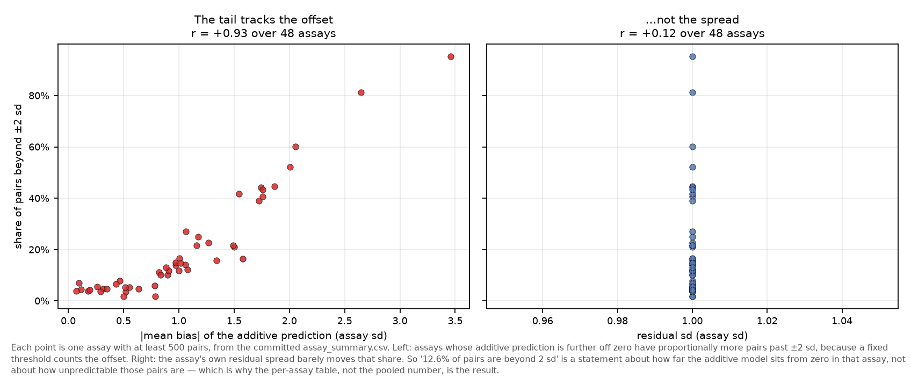

# How far do single-mutant measurements get you on a double mutant?

[](https://github.com/Qwuantabee/epistasis-ceiling/actions/workflows/tests.yml)
[](https://github.com/Qwuantabee/epistasis-ceiling/blob/master/LICENSE)
[](https://github.com/Qwuantabee/epistasis-ceiling/blob/master/pyproject.toml)

Protein engineers screen singles because they are cheap and doubles explode
combinatorially: 1,000 singles imply ~500,000 pairs. The bet is that effects add.
This repo measures how good that bet is on the 65 ProteinGym assays that measure
both singles and doubles, 825,437 doubles in all, and then asks the only
useful follow-up: **can you tell in advance which pairs will break?**

**On the 48 ProteinGym assays with at least 500 measured double mutants (813,014
pairs), adding the two single-mutant effects ranks the double correctly — median
AUC 0.884.** Three candidate priors for *where* additivity
breaks were tested — the size of the singles, residue identity, ESM-2 sequence
context — and **none survives its own null or control**. Which positions are
involved explains a small, real part, but only after fitting on that protein's
own measured doubles, so nothing here tells you in advance where additivity breaks.
A bias claim made by an earlier version is withdrawn; see
[the offset section](#the-additive-models-offset-is-a-convention-which-changes-what-a-fixed-tolerance-means).

The AUC is for placing a double above or below its assay's median observed score,
one value per assay; the unit of evidence is the 48 assays, not the pairs (one
assay, SPG1_STRSG_Olson_2014, holds 535,917 of them).


## The measurement

For every double mutant whose two singles were also measured:

```
residual = observed(double) − ( single_a + single_b − centre )
```

`centre` is the median of every measured variant in the assay (not a measured
wild type; see the section on the offset below), so the baseline is invariant to
an additive shift in the assay scale. Residuals are then divided by each assay's own residual
sd, because ProteinGym assays are **not** on a common scale — the Somermeyer
deep-mutational scans report raw fluorescence in the thousands (residual sd up to
6,098) against a corpus median of 0.69. Pooling those raw would have let three
assays dominate every aggregate number.

| | |
|---|---|
| assays with both singles and doubles | **65** |
| pairs with both singles measured | **818,362** |
| coverage of doubles by their singles | **30.2%–100%**, median **98.5%** |
| median assay Spearman (additive vs observed) | **0.763** |
| median AUC (threshold-free direction) | **0.884** |
| pairs beyond 2 sd from additive, per-assay **median**, median centring | **12.6%** |
| the same, each assay's own offset removed (convention-free) | **4.6%** |
| median assay, fraction of pairs within 1 sd, median centring | **0.431** |
| within 1 sd, each assay's own offset removed (convention-free) | **0.698** |

Three denominators meet on this page, stated once here so no row is ambiguous:
**coverage and the pair total use all 65 assays** (818,362 pairs); **every median
— each correlation, AUC and fraction — uses the 48 assays with at least 500
pairs** (813,014 pairs); and the **corpus-scale ESM probe uses 59 assays**, those
with at least 300 pairs and a parent sequence (817,120 eligible pairs). The 17
assays outside the 48 contribute 5,348 pairs between them and cannot move a
median; the earlier version of this README silently mixed the first two.

So additivity is a good *ranker* (AUC 0.884). Whether it is also an offset
predictor cannot be read off these data, because the offset depends on the
centring convention (see the section on the offset below). An earlier
version said "41% of pairs miss by more than 2 sd" — that was a pooled figure
printed beside per-assay medians, and most of it was the model's systematic offset
rather than its spread.

It also said additivity "resolves only 69% of them in the right direction". That
0.693 is a median split at the OBSERVED median while the prediction sits above
that median 76% of the time, so it measures the offset too. Splitting both series
at their own medians gives 0.802, and the threshold-free AUC is **0.884** — which
is the number to quote. Threshold-free refers to the prediction: the observed score
is still split at its assay median to define the two classes. The statistic that
splits neither series is the rank correlation in the table above.

## A withdrawal, and what does survive

**The magnitude prior is withdrawn.** An earlier version of this README claimed
"additivity fails where the singles look mild". That claim is dead, and the reason
matters more than the claim did.

`residual = observed - predicted`, so `|residual|` contains `|predicted|` **by
construction**. Any correlation between the two is therefore partly structural.
Centring both series within assay removes the arbitrary zero point, and then the
honest control — permute `observed` within assay and **rebuild** the residual —
can be applied:

| statistic | median across 48 assays |
|---|---|
| observed rho(\|residual\|, \|prediction\|), both centred | +0.313 |
| null: within-assay permutation of `observed`, residual rebuilt | **0.502** |
| observed minus null | **−0.189** |
| assays where observed exceeds the null | **2/48** |

The null preserves the construction and destroys only the pairing — and it is
**larger** than the observed value. That is expected rather than mysterious:
large `|predicted|` inflates `|residual|` mechanically even when the double is
independent of its singles, so this statistic cannot be positive evidence of
anything. It carries no usable signal about epistasis in either direction, and
reporting it with a flipped sign would have been just as wrong as the original.
Median-centring instead of mean-centring gives +0.373, and the same verdict.

Two further reasons it was never trustworthy: the additive baseline is identified
only up to one constant per assay, and under the median centring the residual
cloud sits a median **-0.94** assay-sd from zero, so the raw statistic tracks where
zero was placed — it is
-0.469 in assays offset 0.75–1.5 sd and +0.058 in assays offset under 0.25. And
the simulation null that appeared to validate it drew mean-zero Gaussian noise,
so it could not in principle detect the offset that produced the sign.

**What replaces it:** the position and residue probes below. Neither closes the
gap, and the section says how far each one gets.

### The additive model's offset is a convention, which changes what "a fixed tolerance" means

In short: the size and sign of the additive model's offset are set by where
each assay's zero is put, not by additivity, so no signed bias is quoted here as
a finding. The ranking statistic, and every statistic computed after removing
each assay's own offset, do not depend on that choice; a share beyond a fixed
number of sds does. Both conventions side by side, the wild-type anchor, and the
pooled-versus-median table are in [docs/centring.md](docs/centring.md).

Measured per assay, under the
median centring, across the 48 assays the share past 2 sd correlates **+0.93**
with how far that assay's additive prediction sits from zero.



An earlier second panel of this figure was withdrawn; see
[docs/centring.md](docs/centring.md#a-withdrawn-figure-panel).

So "beyond 2 sd" is mostly a restatement of the offset. A tolerance built on it
would flag the assays where the model is shifted, not the pairs where it is wrong.

## Does any of it hold out of sample?

Every median above is over 48 assays. Two things about that set were never tested,
and both matter for anyone who wants to use these results.

**The corpus is mostly one lab.** 48 of the 65 assays are Tsuboyama et al. (2023),
a single study of stability measurements; the other 17 assays come from 13 papers.
Within the 48-assay subset that split is 33 against 15. Both groups rank well
above chance, but not at one level: AUC **0.839** for the 33 Tsuboyama assays
against **0.941** for the 15 others, and the artefact's own verdict for the other
labs' AUC against the corpus median is **NOT_SUPPORTED** (their interval, 0.926 to
0.956, excludes 0.884; percentile bootstrap, 20,000 reps, seed 20261116 as
recorded in `heldout.json`). **That verdict depends on the seed.** With 15 assays
the bootstrap median can only land on a few of the 15 AUCs, and the lower bound
flips between the fifth-lowest (above 0.884) and the fourth-lowest (below it).
Re-run over 200 fixed seeds (`results/seed_sweep.json`; the rule was committed
in `DESIGN.md` before the run), the same function gives SUPPORTED on **131** of
them and NOT_SUPPORTED on **69**. The clearance (the near end of the interval
minus 0.884) has median **-0.004** across seeds and runs from **-0.004** to
**+0.041** (2.5 to 97.5 %). Neither verdict holds on the 190 seeds the rule
requires, so the seed-aggregated verdict is INCONCLUSIVE (seed-dependent).
Read it as "the other labs rank at least as well", not as a measured difference in level. Under the median centring the two groups' bias medians also
differ, **-0.79** against **-1.50** sd (bootstrap p 0.0004), but that is a
difference between centring constants rather than labs: the Tsuboyama median
becomes +1.15 under wild type = 0, and the other labs' wild-type score is not in
the data. Leave-one-lab-out moves the median AUC between 0.880 and 0.941, and the
artefact's verdict is **INCONCLUSIVE**: dropping Tsuboyama alone moves it from
0.884 to 0.941, outside the script's tolerance (a fixed 0.05 of AUC, the
author's choice). What holds is the weaker
statement: every lab family ranks doubles well above chance, and the level
differs by lab family.

**The 17 assays excluded for size are held out by size, not by lab.** They were
dropped for having under 500 pairs (5,348 pairs between them), so they are outside
the three 48-assay medians. But **15 of the 17** are Tsuboyama, the same lab as 33
of the corpus assays, and **11 of the 17** are among the 59 assays of the ESM
probe, so they are not outside every published number. Their ranking agrees with
the corpus (**AUC 0.848**, interval 0.755 to 0.920 around the corpus 0.884;
verdict SUPPORTED). An earlier version also reported that their bias "does not
replicate and even changes sign" (+0.50 against -0.94). That is withdrawn: it
compares centring constants — the median of all variants moves with the share of
doubles in a library, and the small assays have fewer. What the small assays read
under wild type = 0 was not computed: `results/reference.json` covers the 48-assay
corpus only, so no committed number says whether they agree. Anyone quoting "0.94 sd" as a
property of the method is quoting a centring convention.

## Where the failures concentrate

Two probes with valid nulls. Which positions are involved explains a small, real
part of the residual, but only after fitting on that protein's own measured
doubles; residue identity does not survive the magnitude control and is
INCONCLUSIVE. The numbers, the caveats that shrink the position result, and the
two checks for a manufactured effect are in
[docs/failures.md](docs/failures.md).

## Does a stronger baseline close the gap?

Everything above judges additivity — the crudest model a lab could use. The obvious
objection is that the gap is just a weak baseline, so it was measured against
stronger ones: a per-position term, and a low-rank position-pair interaction. Every
per-pair prediction is made by a fit that never saw that pair (out-of-fold, inner
KFold(5) within the assay), the threshold is the same 2 sd for every model, and each
fitted model is compared to a permutation null of itself.

| model | R² of residual var. (null) | AUC (null) | beyond 2 sd (null) | bias, sd (median centring) |
|---|---|---|---|---|
| plain additivity (recomputed) | 0 | 0.884 | 12.6% | **-0.94** |
| + one offset learned on the other assays | 0 | 0.884 | 6.7% | -0.07 |
| + the assay's own offset | -0.001 | 0.884 | 4.6% | 0.00 |
| + position | **0.333** (-0.001) | 0.903 (0.884) | 2.5% (4.6%) | 0.00 |
| + position + position-pair rank 3 | **0.381** (-0.006) | **0.905** (0.884) | 2.5% (4.5%) | 0.00 |

Three things follow, and none of them is position-specific epistasis.

**The offset rows are bookkeeping, not findings.** Removing one offset per assay —
even the offset's own permutation null, which contains no structure at all — takes
the median bias to 0.00 by construction and the beyond-2-sd share from 12.6% to
**4.6%**, the centred figure above. Under the median centring 8 of the 12.6 points
were the additive prediction sitting off zero; the convention-free share is 4.6%.

**Position is mostly absorbing a global calibration.** The best model removes a
median **0.381** of the residual variance (position alone **0.333**), and the pair
model beats its own null in **48/48 assays** on variance removed (the position
term alone in 47/48), so this is not a fitting artefact. But a two-number linear
recalibration of the additive prediction — no positions, no pairs, fitted
out-of-fold and scored on the same metric — removes a median **0.500**, more than
either (`scripts/reference.py`, `results/reference.json`). The additive prediction
is over-dispersed, and most of what the position term buys is that global
correction, not positional structure. The gap is not closed: about half of the
residual variance is left after the recalibration, and these data cannot split
that half into measurement noise and epistasis.

**Ranking barely moves.** Median AUC goes 0.884 → **0.905**, a median gain of
+0.0081, and the pair model wins in only **34/48 assays**. A model that needs 4/5 of
the assay's own measured doubles to gain 8 points of AUC is not what a lab with
singles-only can use.

That last caveat is the important one, and it is in `results/alt_baseline.json`
rather than here: every per-assay row is fitted on 4/5 of **that protein's own
doubles**, so these numbers bound what a stronger baseline can achieve, not what a
singles-only design can. Whole position pairs were held out afterwards, and the
result is in [docs/failures.md](docs/failures.md). What the
table and the recalibration establish together is narrower than the earlier
reading ("the gap is not an artefact of a weak baseline"): a global recalibration
does more than position, and about half of the residual variance survives it — a
gap, but not evidence that the gap is positional.

## Can a protein language model do better?

ESM-2 sequence context was tested on a small sample and again at corpus scale,
with three model heads, a shuffled control and two decision rules side by side.
No head beats its control at either sample size, under either rule, and the
nominal gain over the free prior comes from knowing which assay a pair belongs
to, not from the pair. The verdict table and both runs are in
[docs/esm.md](docs/esm.md).

## Reproducing

Every step, its command, inputs and recorded runtime, and the repository layout
are in [docs/reproducing.md](docs/reproducing.md). The claim audit
(`python scripts/audit_claims.py --strict`) checks every number on this page and
in `docs/` against a committed artefact; `pytest -q` runs it with the tests.

## Limits, stated plainly

- **Additivity is not the only null model — and now that is measured, not promised.**
  The per-position and rank-k position-pair rows above are those stronger baselines.
  They remove a median 0.381 of the residual variance and need 4/5 of the assay's
  own measured doubles to do it; a two-number linear recalibration with no
  positions removes 0.500, so most of what they capture is a global calibration,
  and the position R² is not evidence of position-*specific* epistasis. The
  monotone global-epistasis fit and the whole-position-pair holdout that an
  earlier version of this list named as missing have since been run; see "Where
  the failures concentrate". Neither test uses a second protein: every fit is
  still within one assay.
- **ProteinGym is not one experiment.** Assays differ in scale, saturation and
  what "fitness" means (fluorescence, growth, binding). The normalisation makes
  them comparable in *spread*, not in *meaning*; the per-assay table is the real
  result and the pooled numbers are summaries.
- **Coverage is per assay, not global.** A double whose singles were never
  measured is excluded, which biases toward whatever the DMS library covered. The
  median assay covers 98.5% of its doubles, but the range is wide and one assay
  (F7YBW8_MESOW_Ding_2023) covers only **30.2%** (26 of 86). An earlier draft of
  this README said "≥93.6% per assay", which the coverage column contradicts —
  caught by `scripts/audit_claims.py`.
- **The ESM probe is one architecture.** No head beats its control at corpus
  scale, which does not show that no model can; what the probe leaves
  untested is listed in [docs/esm.md](docs/esm.md#what-the-probe-leaves-untested).
- **Every prior tested here is null, and that is the result.** The magnitude prior
  fails a construction-preserving permutation, residue identity does not survive
  removing the magnitude relationship, and ESM-2 context is indistinguishable from noise. A reader
  who came for "which pairs will break" should leave without an answer; what the
  repo establishes is the size of the gap (AUC 0.884 ranking; 4.6% of pairs beyond
  2 sd once each assay's own offset is removed; an offset whose sign is a centring
  convention) and that three obvious ways to close it do not work. The held-out
  section narrows even that: every lab family ranks well above chance, at levels
  that differ by lab, and the offset is a convention — so quote the AUC and not the
  0.94 sd.
- **Data handling** (gitignored pair tables, the counts that make the
  pooled fraction checkable, two skipped assays): see
  [docs/reproducing.md](docs/reproducing.md#data-notes).

## Part of a set

Six repos, one method: take the number a field reports, measure what a practitioner uses, publish
the gap.

- [admet-split-truth](https://github.com/Qwuantabee/admet-split-truth): does a validation split predict error on the next compounds?
- [mlip-fidelity](https://github.com/Qwuantabee/mlip-fidelity): do ML potentials rank near-degenerate conformers correctly?
- epistasis-ceiling: do single-mutant effects add up on a double mutant?
- [variant-effect-prediction](https://github.com/Qwuantabee/variant-effect-prediction): does a cleaner assay target help zero-shot ESM-2?
- [single-cell-de](https://github.com/Qwuantabee/single-cell-de): are cells replicates?
- [enzyme-kinetics](https://github.com/Qwuantabee/enzyme-kinetics): how wrong is a Lineweaver-Burk Km?

Overview: https://github.com/Qwuantabee
