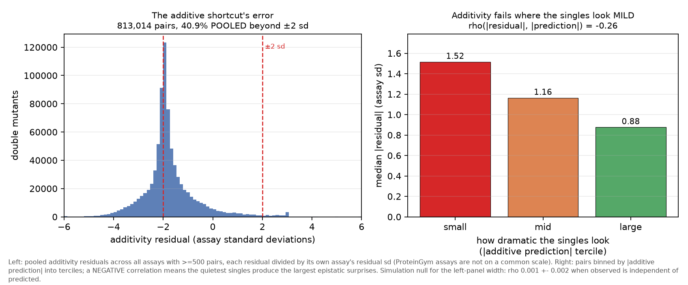

# How far do single-mutant measurements get you on a double mutant?

**On 818,362 measured double mutants from 65 assays, adding the two single-mutant
effects ranks the double correctly — AUC 0.884 — but is biased: the additive
residual sits a median **0.94 assay-sd off zero**, so "beyond 2 sd" mostly reports
that offset rather than unreliability. Two candidate priors were tested and both
**fail their own null**. The honest answer is that neither how dramatic the
singles look nor which residues they involve tells you in advance where additivity
breaks.**



Protein engineers screen singles because they are cheap and doubles explode
combinatorially: 1,000 singles imply ~500,000 pairs. The bet is that effects add.
This repo measures exactly how good that bet is, on the largest public collection
of measured doubles (ProteinGym, 1.77M multi-mutants), and then asks the only
useful follow-up: **can you tell in advance which pairs will break?**

## The measurement

For every double mutant whose two singles were also measured:

```
residual = observed(double) − ( single_a + single_b − centre )
```

`centre` is the assay's own median, so the baseline is invariant to an additive
shift in the assay scale. Residuals are then divided by each assay's own residual
sd, because ProteinGym assays are **not** on a common scale — the Somermeyer
deep-mutational scans report raw fluorescence in the thousands (residual sd up to
6,098) against a median of 0.69 elsewhere. Pooling those raw would have let three
assays dominate every aggregate number.

| | |
|---|---|
| assays with both singles and doubles | **65** |
| pairs with both singles measured | **818,362** |
| coverage of doubles by their singles | **30.2%–100%**, median **98.5%** |
| median assay Spearman (additive vs observed) | **0.760** |
| median AUC (threshold-free direction) | **0.884** |
| pairs beyond 2 sd from additive, per-assay **median** | **12.6%** |
| median assay, fraction of pairs within 1 sd | **0.431** |

Two denominators, stated once so no row is ambiguous: **coverage and the pair
total use all 65 assays** (818,362 pairs), while **every correlation, AUC and
fraction below uses the 48 assays with at least 500 pairs** (813,014 pairs). The
17 small assays contribute 5,348 pairs between them and cannot move a median; the
earlier version of this README silently mixed the two.

So additivity is a good *ranker* (AUC 0.884) and a **biased** predictor, which is
not a contradiction: a monotone but offset predictor still ranks well. An earlier
version said "41% of pairs miss by more than 2 sd" — that was a pooled figure
printed beside per-assay medians, and most of it was the model's systematic offset
rather than its spread.

It also said additivity "resolves only 69% of them in the right direction". That
0.693 is a median split at the OBSERVED median while the prediction sits above
that median 76% of the time, so it measures the offset too. Splitting both series
at their own medians gives 0.802, and the threshold-free AUC is **0.884** — which
is the number to quote.

## A withdrawal, and what does survive

**The magnitude prior is withdrawn.** An earlier version of this README claimed
"additivity fails where the singles look mild". That claim is dead, and the reason
matters more than the claim did.

`residual = observed - predicted`, so `|residual|` contains `|predicted|` **by
construction**. Any correlation between the two is therefore partly structural.
Centring both series within assay removes the arbitrary zero point, and then the
honest control — permute `observed` within assay and **rebuild** the residual —
can be applied:

| statistic | median across 48 assays |
|---|---|
| observed rho(\|residual\|, \|prediction\|), both centred | +0.313 |
| null: within-assay permutation of `observed`, residual rebuilt | **0.502** |
| observed minus null | **−0.189** |
| assays where observed exceeds the null | **2/48** |

The null preserves the construction and destroys only the pairing — and it is
**larger** than the observed value. That is expected rather than mysterious:
large `|predicted|` inflates `|residual|` mechanically even when the double is
independent of its singles, so this statistic cannot be positive evidence of
anything. It carries no usable signal about epistasis in either direction, and
reporting it with a flipped sign would have been just as wrong as the original.
Median-centring instead of mean-centring gives +0.373, and the same verdict.

Two further reasons it was never trustworthy: the additive baseline is identified
only up to one constant per assay, and the residual cloud sits a median **0.94
assay-sd from zero**, so the raw statistic tracks where zero was placed — it is
-0.469 in assays offset 0.75–1.5 sd and +0.058 in assays offset under 0.25. And
the simulation null that appeared to validate it drew mean-zero Gaussian noise,
so it could not in principle detect the offset that produced the sign.

**What replaces it:** the position and residue probes below. Neither closes the
gap, and the section says how far each one gets.

### The additive model is biased, which changes what "a fixed tolerance" means

The residual mean is **0.94 assay-sd** per assay,
not zero. A "fraction beyond a fixed number of sds" is then measuring that offset,
not the model's spread — and a pooled fraction is not comparable to a per-assay
median:

| how it is counted | value |
|---|---|
| pooled share beyond 2 sd — **what this README used to call 40.8%** | 40.9% (332,751 / 813,014) |
| per-assay **median** share beyond 2 sd | 12.6% |
| per-assay median after centring each assay | 4.6% |
| pooled share beyond 2 sd, centred | 5.8% |

The honest figure is the middle row, **12.6%**;
the 41% was that number blended with the model's systematic bias. What additivity
*is* good at is ranking: **AUC 0.884** against the observed effect,
which is why screening by additive prediction still beats not screening at all.

The same argument, measured per assay rather than asserted pool-wide: across the
48 assays the share past 2 sd correlates **+0.93** with how far that assay's
additive prediction sits from zero, and only **+0.12** with its own residual
spread.


So "beyond 2 sd" is mostly a restatement of the offset. A tolerance built on it
would flag the assays where the model is shifted, not the pairs where it is wrong.

## Does any of it hold out of sample?

Every number above is a median over 48 assays. Two things about that set were
never tested, and both matter for anyone who wants to use these results.

**The corpus is one lab.** 48 of the 65 assays are Tsuboyama et al. (2023), a
single study of stability measurements; the other 17 assays come from 13 papers.
Split by that line, the bias is not one number: **-0.79** sd (95% CI -0.97 to
-0.35) for the Tsuboyama assays against **-1.50** sd (-1.87 to -1.27) for the
rest, a difference of 0.76 sd with a bootstrap p of 0.0004. Both keep the sign and
both rank well (AUC 0.839 against 0.941), so the *direction* replicates and the
*magnitude* does not. The corpus median is a mixture description.

**The 17 assays that were excluded agree about ranking and disagree about bias.**
They were dropped for size — under 500 pairs, 5,348 pairs between them — which
makes them the only genuinely out-of-sample check available without new data: they
contributed nothing to any published number. Their median bias is **+0.50** sd
(95% CI -0.84 to +1.01) against the corpus's -0.94, i.e. it does not replicate and
even changes sign, while their ranking agrees (**AUC 0.848**, inside the corpus
interval).

The reading is the same in both tests, and it is narrower than the version of this
page that came before them: **additivity ranks doubles well wherever you look, and
its offset is assay-specific, not a constant you can subtract.** Anyone quoting
"0.94 sd" as a property of the method is quoting one lab's calibration.

Leave-one-lab-out confirms the split: dropping any single lab moves the AUC only
between 0.880 and 0.941, so the ranking is a corpus property rather than one
paper's, while the bias moves across the whole -1.50 to -0.90 range on the same
test.

## Where the failures concentrate

Two probes with valid nulls — one holds, one does not, and the second one is a
correction of a correction.

**Positions matter, but less than the raw number suggests.** The share of residual
variance explained by which sequence positions are involved is **0.140**
against a permutation null of 0.002, exceeding it in **47/48 assays**. Three
caveats, all measured, because the first version of this section overstated it:

- The median assay has only **4** distinct positions (11 assays have just 2), so
  this is usually a four-group contrast, not a map of hot residues. It is weakest
  exactly where the promise would matter: median R² is 0.189 for 3–5 positions and
  0.054 for 21–60.
- It shrinks to **0.092** once the assay's own bias is removed, and the verdict is
  judged on that centred figure rather than the raw 0.140.
- Grouping by **which single mutation** is involved instead of by position gives R²
  **0.343** — a strictly finer grouping, and therefore an upper bound on how much
  is specifically about position. Pairs sharing a mutation are similar largely
  because single-mutant effects are shared.

Flagging the hottest 10% of positions touches a median of **23%** of pairs (range
1%–67%), so the operational promise is real but modest — not "at no extra cost".

**Residue identity: INCONCLUSIVE, and the earlier negative was wrong too.** With
both substitution slots pooled (the earlier version read only slot `a`, an
arbitrary and non-random half of each pair) and an exact binomial instead of a
threshold picked by eye, alanine sits above its own assay's median residual in
**73% of 48 assays**, Bonferroni p = 0.042. But two independent checks say that is
not residue-specific epistasis:

- the residue ranking reproduces across independent assay halves at only
  **ρ +0.50** — chance;
- alanine's fraction drops to **0.52**, exactly chance, once the magnitude
  relationship is regressed out within assay.

So the marginal p-value is the magnitude confound leaking through. An earlier
draft called this NOT_SUPPORTED on an arbitrary 85% bar, which was a statement
about the bar and not a test; a later one nearly called it SUPPORTED on a p-value
alone. Both were wrong. Verdict **INCONCLUSIVE**: no residue shows a reproducible,
magnitude-independent effect at this sample size.

### Two ways this could have been manufactured, and why it wasn't

Both were tested before the reviewer round, because each would have produced a
finding out of nothing:

- **Per-assay normalisation.** Dividing each assay's residual by its own sd is a
  scalar per assay, so it cannot change a within-assay rank correlation.
  Recomputing on the raw residuals gives **-0.260 raw against -0.260 normalised**,
  with a maximum difference of exactly 0.0 across all 48 assays. The normalisation
  makes assays comparable in spread; it does not create an effect.
- **Position clustering as a count artefact.** If a high r² simply meant "few
  pairs per position", it would track position count. It does not: ρ = +0.027
  against pairs-per-position and -0.055 against number of positions, and 44 of 48
  assays still exceed five times the analytic null. The clustering is not a count
  artefact — the caveats above are about what the number *means*, not whether it
  is real.

## Can a protein language model do better?

Three probes. The first two were in the earlier draft; the third is the one that
was actually needed, and the earlier ESM numbers were withdrawn.

- **Distance alone**: ρ = -0.03, MAE worse than a constant by 0.086 sd. Nothing.
- **ESM-2 (650M) alone**, window embeddings of both mutated positions plus their
difference, product and sequence separation: ρ = **-0.003 ± 0.049**, against a
**pure-noise control of +0.007 ± 0.014** run through the identical pipeline. MAE
is 2% worse than predicting the training median. Sequence context carries no
usable signal here.
- **ESM-2 + the free prior**: ρ = -0.007, i.e. **worse than the prior alone
(+0.231)** by 0.238. Adding 5,121 ESM features to the one variable a lab already
has makes the prediction worse.

The earlier draft reported ρ = +0.064 and an MAE "worse than a constant by 1.43
sd". Both are withdrawn. The MAE was estimator failure, not a property of ESM-2:
a 1.43-sd deficit implies mean absolute error of 1.55 on a target whose median is
1.44, so the model was predicting outside the data range — 5,121 near-collinear
features, a StandardScaler, Ridge alpha=10 and no target transform on a
non-negative right-skewed target. Two further defects: there was no noise control
at all, and the assay list was chosen by alphabetical glob order, which silently
dropped the assay that is 65% of the corpus. The re-run fixes all four and reports
the noise floor beside every number.

**So sequence context does not tell you where additivity breaks — and neither, on
these data, does anything else tested here.** The three candidate priors are all
null: the magnitude of the singles (fails a construction-preserving permutation),
residue identity (rank correlation across assay halves +0.50), and ESM-2 context
(indistinguishable from pure noise, and actively harmful on top of the prior).
What survives is the ranking result, AUC 0.884, and the fact that the residual is
biased — neither of which lets you pick the pairs in advance.

## Reproducing

```bash
pip install -r requirements.txt

# 1. additivity residuals for every assay (writes results/pairs/*.csv)
python scripts/build_pairs.py \
    --data <ProteinGym dir with <assay>.csv> \
    --index <DMS_substitutions.csv>

# 2. the per-assay summary (build_pairs writes it; this rebuilds it from the
#    pair tables alone, which is what CI and a fresh clone can actually do)
python scripts/rebuild_summary.py

# 3. the magnitude prior and the null that withdraws it
python scripts/prior.py
python scripts/invariant_stats.py

# 4. the depth probes: position, residue, centred prior
python scripts/depth.py

# 5. the ESM-2 probe (GPU; needs a parent-sequence index)
python scripts/esm_context.py --index <DMS_substitutions.csv>

# 6. the claim audit, then the tests
python scripts/audit_claims.py
pytest tests/
```

The audit is also a test (`tests/test_claims.py`), so CI fails on a stale number
as well as on a broken function.

## Limits, stated plainly

- **Additivity is not the only null model.** A model that fits single-mutant
  effects with a per-position term would beat plain additivity; this repo measures
  the crudest baseline first, deliberately, because that is what a lab actually
  uses when it "just adds the singles".
- **ProteinGym is not one experiment.** Assays differ in scale, saturation and
  what "fitness" means (fluorescence, growth, binding). The normalisation makes
  them comparable in *spread*, not in *meaning*; the per-assay table is the real
  result and the pooled numbers are summaries.
- **Coverage is per assay, not global.** A double whose singles were never
  measured is excluded, which biases toward whatever the DMS library covered. The
  median assay covers 98.5% of its doubles, but the range is wide and one assay
  (F7YBW8_MESOW_Ding_2023) covers only **30.2%** (26 of 86). An earlier draft of
  this README said "≥93.6% per assay", which the coverage column contradicts —
  caught by `scripts/audit_claims.py`.
- **The ESM probe is one architecture, one feature set and one window size.** It
  shows *this* model does not rank epistasis from context; it does not prove no
  model can. A trained supervised model on matched data is the obvious next test,
  and it was not run. The probe also uses 36,000 pairs (4.4% of the corpus) and
  24 assays by size rank; the selection is reported in `results/esm_context.json`
  rather than left implicit, but it is a sample, not the corpus.
- **Every prior tested here is null, and that is the result.** The magnitude prior
  fails a construction-preserving permutation, residue identity does not replicate
  across assay halves, and ESM-2 context is indistinguishable from noise. A reader
  who came for "which pairs will break" should leave without an answer; what the
  repo establishes is the size of the gap (AUC 0.884 ranking, 12.6% of pairs
  beyond 2 sd, marked bias) and that three obvious ways to close it do not work.
- **`results/pairs/` is gitignored** (101 MB, reproducible). That used to mean a
  fresh clone could not check the pooled fraction and the audit had to announce
  reduced coverage. `assay_summary.csv` now carries the integer counts
  (`n_outside_2sd`, `n_outside_2sd_centred`, `n_within_1sd`) beside every
  fraction, so the pooled number is `n_outside_2sd.sum() / n_pairs.sum()` —
  computable in a clone from a committed file, and exact where a fraction times a
  row count only round-trips by luck. `tests/test_claims.py` still guards that a
  claim which stops being checkable is named rather than dropped.
- **Two assays were skipped** (F7YBW8_MESOW_Aakre_2015, GCN4_YEAST_Staller_2018)
  for having too few singles or doubles by the stated threshold; see
  `results/skipped.txt`.

## Layout

```
src/epsceil/pairs.py        mutation parsing, additivity residual, per-assay scaling
scripts/build_pairs.py      every assay -> results/assay_summary.csv + pairs/
scripts/rebuild_summary.py  per-assay summary from the pair tables alone
scripts/prior.py            the magnitude prior + its permutation null
scripts/invariant_stats.py  shift-invariant correlations, AUC, bias accounting
scripts/depth.py            position, residue and centred-prior probes
esm_context.py              the GPU probe, grouped CV by assay
scripts/make_figures.py     figures from committed artefacts
scripts/audit_claims.py     every README number against a committed artefact
tests/                      invariants, estimator labels, the claim audit
```

MIT licence for this repository's own code. ProteinGym data keeps its own terms.
